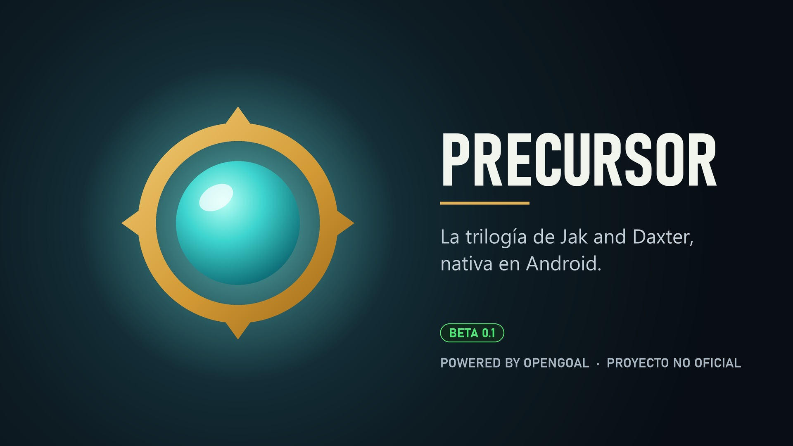
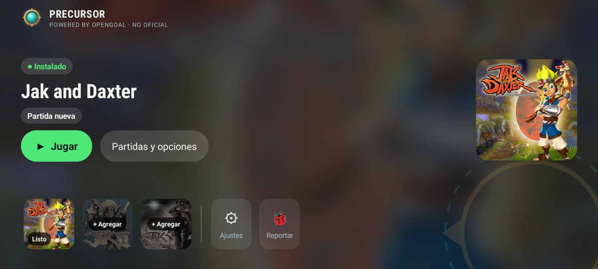
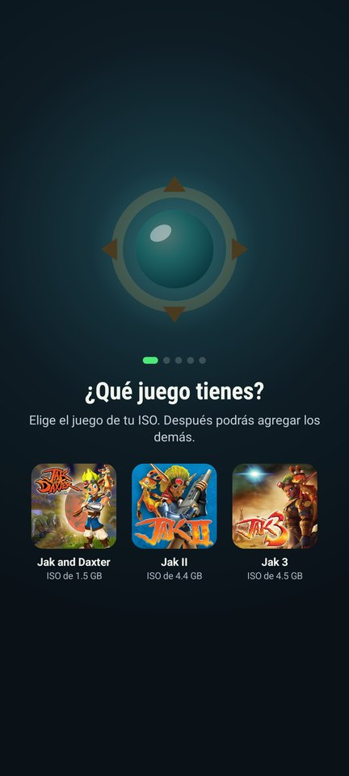
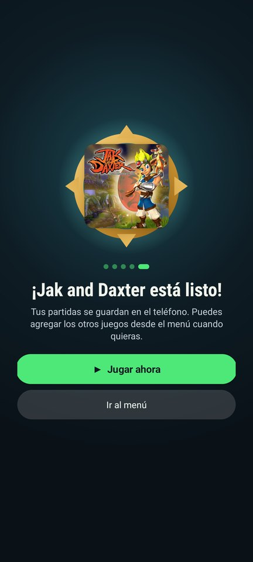
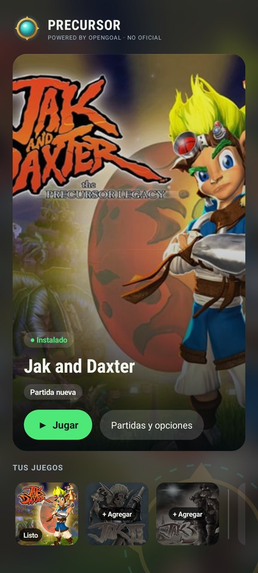
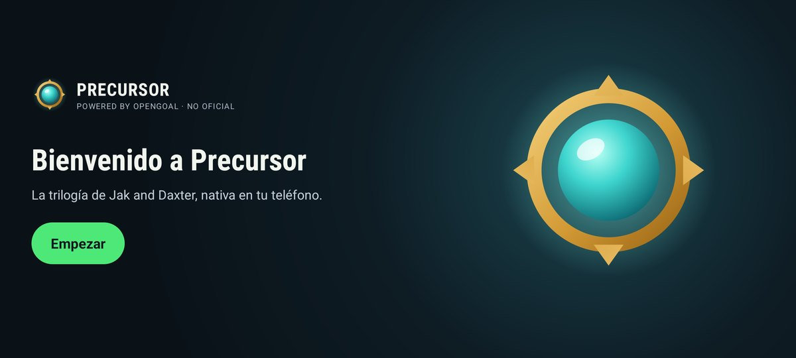
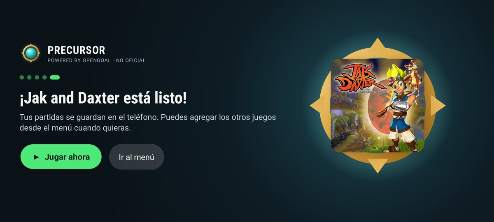
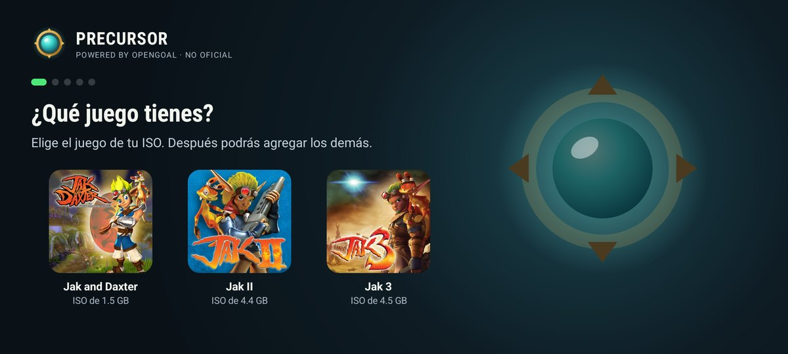
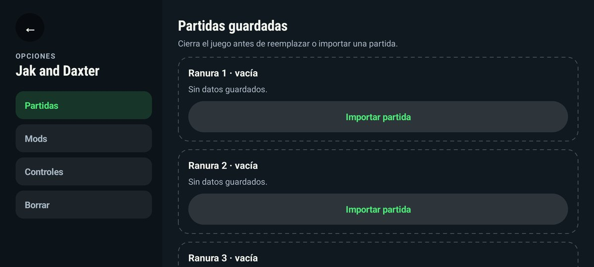

# Precursor

<p align="center"></p>

**Precursor · powered by [OpenGOAL](https://opengoal.dev)**

La trilogía de Jak and Daxter, nativa en Android ARM64. Es un port experimental y **no oficial**
construido sobre OpenGOAL.

> [!NOTE]
> **English summary:** Precursor, powered by OpenGOAL, is an unofficial, non-profit fork of
> [OpenGOAL](https://github.com/open-goal/jak-project) that tries to run the Jak trilogy natively
> on Android (arm64-v8a). "Powered by OpenGOAL" means it is built on OpenGOAL's code; it does not
> mean the OpenGOAL team made or approved it. The OpenGOAL team does not make, endorse or support it. All three games
> (Jak 1, Jak 2 and Jak 3) are being worked on and already boot and run on a real phone, but
> everything is **experimental** and none of them has been verified end to end. Please don't report problems with this fork to the OpenGOAL
> team. You need your own legally purchased copy of the game, and no game assets are included.

---

## Qué es este proyecto

[OpenGOAL](https://opengoal.dev) es el proyecto que descompiló la trilogía original de Jak and
Daxter de PS2 y la convirtió en una aplicación nativa de PC. El juego original está escrito casi
entero en GOAL, un lenguaje tipo LISP creado por Naughty Dog. El equipo de OpenGOAL escribió su
propio compilador de GOAL para x86-64, un descompilador y las herramientas para extraer y
reempaquetar los assets del juego. Todo eso es trabajo suyo y la base de este repositorio.

**Este fork intenta llevar ese trabajo a Android.** El objetivo no es emular ni interpretar, sino
lo mismo que busca OpenGOAL en PC: que el juego corra como código nativo, en este caso en
teléfonos ARM64. Para eso hace falta:

- **Un backend ARM64 para el compilador de GOAL** (`goalc --arch arm64`). El código del juego se
  compila directamente a instrucciones AArch64 en vez de x86-64.
- **Puentes de llamada C++ ↔ GOAL para ARM64** (trampolines y rutinas en ensamblador del kernel).
- **El renderer portado a OpenGL ES 3.2.** Android solo ofrece GLES, no OpenGL de escritorio.
- **Un APK de Android** basado en SDL3 (`SDLActivity`), con audio por cubeb (AAudio/OpenSL ES).

El proyecto se desarrolla con ayuda de IA (ver [Desarrollo asistido por IA](#desarrollo-asistido-por-ia)).

## La app

<p align="center">
  
</p>

Precursor es un solo launcher para los tres juegos. Tú pones la ISO de tu disco y la app hace el
resto en el teléfono: la comprueba, extrae los archivos, compila el juego para ARM64 y lo deja
listo para jugar. No hace falta una PC.

<table>
  <tr>
    <td width="33%"></td>
    <td width="33%"></td>
    <td width="33%"></td>
  </tr>
  <tr>
    <td align="center"><sub>Inicio guiado</sub></td>
    <td align="center"><sub>Juego listo</sub></td>
    <td align="center"><sub>Estante en vertical</sub></td>
  </tr>
</table>

- **Inicio guiado.** La primera vez te lleva paso a paso: elegir el juego, buscar la ISO,
  comprobarla y prepararla. El orbe muestra el avance: cada etapa terminada enciende una de sus
  puntas. Puedes salir mientras tanto y la app te avisa al terminar.
- **El Estante.** Los juegos instalados, tu última partida y los botones para jugar, administrar
  partidas y mods, o agregar otro juego. Funciona en horizontal y en vertical.
- **Mando o pantalla táctil.** Todo el launcher se maneja con un mando (Xbox, PlayStation o
  Nintendo, con sus propios botones en pantalla). En el juego hay controles táctiles que se
  ocultan solos al conectar un mando.
- **Menú dentro del juego.** Con Atrás, el botón MENÚ o Select + Start vuelves a Precursor sin
  cerrar la app.
- **Reportes de fallos.** Si el juego se cierra solo, la app ofrece crear un reporte con los
  registros técnicos (nunca tus partidas ni la ISO) para compartirlo por Discord o correo.

<table>
  <tr>
    <td width="50%"></td>
    <td width="50%"></td>
  </tr>
  <tr>
    <td width="50%"></td>
    <td width="50%"></td>
  </tr>
</table>

<sub>Capturas del launcher (las del juego en sí vendrán cuando esté más avanzado). Las portadas
y los nombres de los juegos pertenecen a sus dueños y solo identifican cada juego; Precursor no
incluye ningún archivo de los juegos.</sub>

## Estado actual

**El port abarca los tres juegos: Jak 1, Jak 2 y Jak 3.** Se trabaja en los tres, y los tres ya
abren y corren en un teléfono Android real. Todo es **experimental**: ninguno está terminado ni
se ha comprobado de principio a fin.

| Juego | Hasta dónde llega hoy |
| --- | --- |
| Jak 1 | Título, intro, menú, partida nueva y gameplay inicial, a ~60 FPS, con controles táctiles y audio. Es el más avanzado. |
| Jak 2 | Intro, título, la ciudad y la prisión. Las colisiones ya funcionan. Quedan crashes puntuales en revisión. |
| Jak 3 | Menú, partida nueva y la primera cinemática completa. Después se queda en pantalla blanca (bug en investigación). |

Además:

- **La app Precursor** (paquete `io.github.thebardockgames.precursor`) valida tu ISO, extrae los
  assets y compila el juego para ARM64 directamente en el teléfono. Después lanza cada juego por
  separado, con guardados independientes.
- El backend ARM64 del compilador compila el código completo de los tres juegos. La mayoría de
  sus arreglos (registros, vectores, pila, llamadas) sirven para los tres a la vez.
- El renderer funciona sobre OpenGL ES 3.2, con controles táctiles, pantalla completa y audio
  que se pausa al minimizar.
- Las pruebas de regresión nativas ARM64 (`test/arm64_runtime`) pasan en el dispositivo.

## Sin fines de lucro y con respeto al trabajo original

- Es un proyecto **sin ánimo de lucro**. No vende nada, no acepta donaciones a cambio del juego y
  no distribuye nada que pertenezca a Sony Interactive Entertainment o Naughty Dog.
- **"Powered by OpenGOAL" significa que está construido con el código de OpenGOAL, no que el
  equipo de OpenGOAL lo haya hecho o aprobado.** Precursor no tiene ninguna relación oficial con
  ellos. Todo el
  mérito de la descompilación, el compilador, el runtime y las herramientas es de
  [los contribuidores de OpenGOAL](https://github.com/open-goal/jak-project/graphs/contributors).
  Este fork solo añade el trabajo específico de Android encima.
- Se mantiene la licencia original del proyecto ([ISC](./LICENSE), © OpenGOAL Team). El código
  de terceros en `third-party/` conserva sus propias licencias.
- *Jak and Daxter* y sus marcas pertenecen a Sony Interactive Entertainment y Naughty Dog.
- **No reportes problemas de este fork en el repositorio, el Discord ni los canales de
  OpenGOAL.** Cualquier fallo aquí probablemente lo causen los cambios de este fork, no
  OpenGOAL. Si quieres jugar en PC, usa [la versión oficial de OpenGOAL](https://opengoal.dev).
- Este fork se desarrolla con ayuda de IA; los commits lo indican con `(AI-assisted)`. Más
  detalles en [Desarrollo asistido por IA](#desarrollo-asistido-por-ia).

> [!WARNING]
> **Necesitas tu propia copia del juego, comprada legalmente.** Este repositorio no incluye
> assets de los juegos originales. Tienes que extraerlos tú de un disco de PS2 legítimo (PAL,
> NTSC o NTSC-J). Las versiones de PS3/PS4/PS5 no sirven.

## Compilar

### Herramientas de PC (compilador, descompilador, tests)

Se compilan igual que en OpenGOAL. Para configurar el entorno, sigue la guía de tu sistema
([Windows](./docs/setup/system/windows.md), [Linux](./docs/setup/system/linux.md),
[macOS](./docs/setup/system/macos.md)). El proyecto usa [Task](https://taskfile.dev):

```sh
task gen-cmake-release
task build-release
task set-game-jak1
task set-decomp-ntscv1   # o set-decomp-pal, etc.
task extract             # con la ISO extraída en iso_data/jak1
```

### Código del juego para ARM64

El `goalc` de PC compila el código GOAL a ARM64 con `--arch arm64`:

```sh
./out/build/Release/bin/goalc -g jak1 -a arm64 --proj-path <carpeta-data> -c '(make-group "all-code" :force #t)'
./out/build/Release/bin/goalc -g jak1 -a arm64 --proj-path <carpeta-data> -c '(mi)'
```

### APK de Android

Requiere el Android SDK y el NDK `29.0.14206865`. El APK es solo para arm64-v8a, con mínimo
Android 9 (API 28).

```sh
cd scripts/android-port/apk
./gradlew assembleDebug -PopenGoalGame=launcher   # o jak1, jak2, jak3
adb install -r app/build/outputs/apk/debug/app-debug.apk
```

- **Precursor** (`launcher`, opción por defecto): eliges tu ISO desde el teléfono y el launcher
  hace el resto (validar, extraer y compilar).
- **APK por juego** (`jak1`, `jak2`, `jak3`): para desarrollo. Los datos compilados en el PC se
  copian al almacenamiento interno de la app.

Todas las variantes generan el mismo archivo `app-debug.apk`, así que confirma cuál
compilaste antes de instalarlo.

### Tests

```sh
./test.sh                                   # suite de goalc-test en PC
goalc-test --gtest_filter="*ARM64*"         # solo los tests del emisor ARM64
```

Las pruebas de ejecución ARM64 en un dispositivo real están en
[`test/arm64_runtime`](./test/arm64_runtime/README.md).

## Estructura del repositorio

| Carpeta | Contenido |
| --- | --- |
| `goalc/` | Compilador de GOAL. El emisor ARM64 está en `goalc/emitter/IGenARM64.cpp` |
| `game/` | Runtime en C++: kernel, renderer (GLES 3.2 en Android) y sonido |
| `overlord/` | Emulación del IOP (carga de datos y audio) |
| `goal_src/` | Código fuente GOAL descompilado de los juegos |
| `decompiler/` | Descompilador y extractor de assets |
| `scripts/android-port/` | APK de Android, prueba de concepto con CMake y scripts de verificación |
| `test/` | Tests unitarios, del emisor y de ejecución ARM64 |

La documentación técnica general de OpenGOAL sigue siendo válida:
[`docs/project-overview.md`](./docs/project-overview.md) y <https://opengoal.dev/docs/intro>.

## Desarrollo asistido por IA

Precursor se desarrolla con ayuda de inteligencia artificial: **Claude** (de Anthropic), a través
de Claude Code, escribe y revisa buena parte del código, los diagnósticos y la documentación del
port, siempre dirigido y probado en teléfonos reales por el autor. Los commits hechos así llevan
`(AI-assisted)` y la línea `Co-Authored-By: Claude`.

Si contribuyes, sigue la misma regla: indica `(AI-assisted)` cuando uses IA.

## Contribuidores

| | Rol |
| --- | --- |
| **[thebardockgames](https://github.com/thebardockgames)** | Autor y responsable de Precursor: dirección, pruebas en dispositivos y publicación |
| **Claude** (Anthropic, vía Claude Code) | Asistente de IA: código del port ARM64/Android, launcher, diagnósticos y documentación |
| **[Contribuidores de OpenGOAL](https://github.com/open-goal/jak-project/graphs/contributors)** | Todo el proyecto en el que se basa Precursor |

## Créditos

- **[OpenGOAL](https://github.com/open-goal/jak-project)** y todos sus contribuidores, por el
  proyecto en el que se basa todo esto.
- **[SDL](https://github.com/libsdl-org/SDL)** por la capa de ventana y entrada en Android, y
  **[cubeb](https://github.com/mozilla/cubeb)** por el audio.
- **Naughty Dog**, por crear Jak and Daxter y GOAL.
